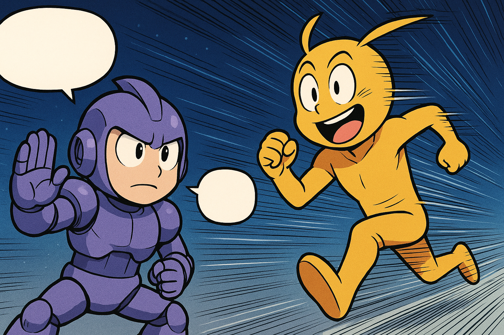

## 今週のAIニュース漫画



---

## 導入：AIが「自己改善・検索戦争・ルール整備・統合」で動いた1日

2026年11月4日——中間選挙翌日の今日、AI業界では「Anthropicが自己改善警告をIPO申請書に正式記載」「ChatGPTがGoogleの検索量の20%相当に到達」「4大AI企業がウェブのAI学習オプトアウト共通ルールを発表」「Google検索がAI機能を完全統合」という大きな動きが重なりました。これらは個別のニュースではなく、AIが「競争」から「社会インフラ化」へと移行する構造的転換を示しています。

---

## 1. Anthropic「AIが近く自分自身の後継者を設計する可能性」——IPO申請書に前例なき警告

**何が起きた？**

AnthropicはSECへのS-1改訂版（S-1/A）に、**「当社のAIモデルが近く、Responsible Scaling Policy（責任あるスケーリング方針）における再帰的自己改善（Recursive Self-Improvement）の閾値に達する可能性がある」** という一文を追加しました。

これはAI企業が上場申請書に「自社AIが近くAGIへの扉を開く可能性がある」と明記した、業界初の事例です。

**再帰的自己改善とは何か？**

AIが自分自身を改良・改造できるようになること。現在のAIは人間が設計・訓練しますが、再帰的自己改善が始まると：
- AIが自分よりも性能の高いAIを設計・訓練する
- その高性能AIが、さらに優れたAIを作る……という連鎖が始まる
- 人間が「次の一手」を制御できなくなるリスクが急上昇する

**Claudeがすでにコードの80%超を書いている**

これは抽象的な話ではありません。Anthropicは同時期に「Claude（AnthropicのAI）が、現在すでに同社コードベースにマージされたコードの **80%超** を書いている」とも公表しました。AIが自社の開発を加速する——再帰的改善への入口はすでに開いています。

**Anthropicは「協調的な一時停止」を提案**

AnthropicはライバルのOpenAI・Google・Metaに「単独ではなく、業界横断で検証可能な方法での開発ペース調整」を呼びかけています。ただし批評家からは「IPO直前の安全性アピール」という見方もあります。

**ロードショーは11月9日週から開始**

IPOのロードショー（機関投資家向け説明会）は **11月9日（月）週に開始** し、感謝祭（11月26日）前の上場価格決定を目指します。評価額は **$1.5〜1.6兆ドル** に引き下げられており（当初$2兆ドル目標）、Goldman Sachs・Morgan Stanleyが主幹事です。

**なぜ重要？**

「AIは危険かもしれない」と自ら申告しながら兆ドル規模のIPOを進める——Anthropicのこのアプローチは「安全性への投資こそが最大のリスク管理」という資本市場への新しいメッセージです。同時に、機関投資家や政策立案者がAIの「臨界点」について正式な財務書類で初めて読む機会となります。

> 参考: [Anthropic Warns AI Could Soon Design Its Own Successor](https://openthemagazine.com/business/anthropic-warns-ai-could-soon-design-its-own-successor-raising-control-concerns) / [Anthropic says Claude writes 80%+ of merged code](https://www.tomshardware.com/tech-industry/artificial-intelligence/anthropic-says-claude-now-writes-more-than-80-percent-of-its-merged-code)

---

## 2. ChatGPTがGoogleの検索量の「20%」に到達——検索戦争が本格化

**何が起きた？**

OpenAIの幹部が「ChatGPTの検索クエリ数は、現在Googleの検索量の **約20%相当** に達している」と発表しました。ChatGPT Searchのローンチからわずか1年ほどでの急成長です。

**数字の意味を整理する**

Googleの日次検索数は約140〜160億件と推定されます。20%相当ということは、ChatGPTが1日あたり約28〜32億件の「検索的な質問」を処理している計算になります。ただし：
- OpenAIの定義する「検索クエリ」と、Googleの従来型「検索クエリ」は性質が異なります
- Googleの全体シェアは依然として全世界の約80%を占めています
- ChatGPTはConversational AI（会話型）で、「検索」だけでなく「作業支援」も含むため単純比較は難しい

それでも、AI検索が「挑戦者」から「準主流」へと移行しつつあることは明確です。

**GoogleとChatGPTの「答え方の違い」**

Googleは **リンクの羅列** から **AIが要約した直接回答（AI Overviews）** へと進化中。ChatGPTは最初から **会話で直接回答** するスタイル。ユーザーがどちらを「より使いやすい」と感じるかの競争が、今まさに佳境を迎えています。

**なぜ重要？**

Googleの検索広告収益は年間2,000億ドル超。ChatGPTが「答えてしまう」ことで広告クリックが減れば、Googleの主力事業に直接打撃が来ます。これは「AIが既存産業を食う」最も大きな実例です。

> 参考: [ChatGPT reaches 20 percent of Google search volume](https://www.newsy-today.com/chatgpt-reaches-20-percent-of-google-search-volume-openai-says/)

---

## 3. OpenAI・Google・Microsoft・Anthropicが「AIウェブ学習オプトアウト」共通規格に合意

**何が起きた？**

4大AI企業が **robots.txtに `__usage_ai-training` トークンを追加するだけで、AI学習からサイトを除外できる共通規格** を採用することで合意しました。ウェブサイト運営者にとっては「一行追加するだけでAI学習を断れる」世界が実現します。

**仕組みを簡単に説明すると**

robots.txtは、Googleなどの検索エンジンロボットに「このページは読んで良い/ダメ」と伝えるファイルです。これまでAI学習用クローラーの制御は各社バラバラでした。今回の合意で：

```
User-agent: *
Disallow: __usage_ai-training
```

のような形式で、全AI企業に対して一括でオプトアウト表明できるようになります。

**各社の実装スケジュール**

| 企業 | 対応開始時期 |
|------|-------------|
| Anthropic | 即時対応済み |
| OpenAI | 数ヶ月以内 |
| Microsoft | 2027年2月1日 |
| Google | 2027年初頭 |

**なぜ重要？**

これまで「AIに無断でコンテンツを学習されたくない」と思うウェブサイト運営者やメディアは、各社のクローラーを個別にブロックするか、訴訟するしかありませんでした。共通規格の合意は「AIとコンテンツ作成者の新しい関係構築」の第一歩です。ただし、すでに学習済みのデータには遡及適用されず、実効性については今後の動向が注目されます。

> 参考: [Google, Microsoft, OpenAI and Anthropic back one AI training opt-out](https://thenextweb.com/news/ai-training-opt-out-robots-txt-google-openai-microsoft-anthropic) / [OpenAI, Google, Microsoft, Anthropic Back One AI Opt-Out Token](https://aiweekly.co/alerts/openai-google-microsoft-anthropic-back-one-ai-opt-out-token)

---

## 4. OpenAIがコーディングスタートアップ「Ona」を買収——Codexをエージェント最適化へ

**何が起きた？**

OpenAIが **Ona（旧Gitpod）** を買収することを発表しました。OnaはAIエージェントの実行環境・クラウド開発環境を専門とするスタートアップで、エージェントが長時間にわたる複雑なコーディングタスクを安全に実行できる環境の提供に強みを持ちます。

**なぜOpenAIはOnaを買ったのか？**

現在のAIコーディングツール（GitHub Copilot、Claude Code、Cursorなど）は、主に「人間が書いたコードを補完する」スタイルです。しかしOpenAIが目指すのは **「Codexエージェントが何時間もかけて、複数ファイルにわたる大規模なタスクを自律的にこなす」** 次世代の開発スタイル。

Onaの技術は：
- エージェントが安全にコードを実行できる分離環境の提供
- 長時間タスクの中断・再開に対応
- 複数のエージェントが並行作業できるオーケストレーション

これらをCodexに組み込むことで、GitHubに「対抗する」というよりも「AIエージェントが主体となる新しい開発フロー」を作ることが目標とみられます。

**なぜ重要？**

プログラミングはAIによる自動化が最も進んでいる知的労働分野の一つです。エージェントが「人間の代わりにコードを書く」時代が来れば、ソフトウェア開発の仕事の形は根本から変わります。今回の買収はその「次のステージ」への布石です。

> 参考: [OpenAI buys Ona to push Codex toward long-running autonomous coding tasks](https://the-decoder.com/openai-buys-ona-to-push-codex-toward-long-running-autonomous-coding-tasks/)

---

## 5. Google検索がAI機能を完全統合——AI OverviewsとAI Modeが一つになって世界展開

**何が起きた？**

Googleが **AI OverviewsとAI Modeを一つの「AI検索体験」に統合し、デスクトップ・モバイル両方で全世界展開** しました。これにより：
- 検索結果の上部にAIの要約が表示される「AI Overviews」
- 会話形式で深掘り質問できる「AI Mode」

の両機能が、シームレスに連携するようになります。

**どう変わるのか？**

これまでは「検索結果ページにAI要約が表示される」（AI Overviews）と「Geminiと会話しながら調べる」（AI Mode）が別々の機能でした。統合後は：

1. 検索キーワードを入力するとAIが要約と関連情報を表示
2. そのまま「もう少し詳しく教えて」「○○の場合はどう？」と会話を続けられる
3. 必要なら従来のリンク一覧にも切り替えられる

という一体型の体験になります。Googleは「答えを探す場所」から「AIと対話しながら理解を深める場所」へと進化しています。

**「学校向け」ではGoogleがAIとSearchの選択を迫る動きも**

一方で、Google Workspaceの教育機関向けプランでは、AIとSearchのどちらかを選ばせる動きも報じられています。教育現場でのAI利用をどう扱うかは、世界各国で議論が続いています。

**なぜ重要？**

Googleは世界最大の情報インフラです。その検索体験がAI中心に再設計されることは、私たちが「知りたいことを調べる」行動そのものを変えます。Web上の全サイトのトラフィックへの影響も大きく、コンテンツ制作者にとっても「AIに読まれるコンテンツ」の書き方が重要になってきます。

> 参考: [Google merges AI Overviews with conversational AI Mode for seamless search](https://arynews.tv/google-merges-ai-overviews-with-ai-mode-feature)

---

## 6. AnthropicがClaudeモデルに「透かし」導入——AI生成コンテンツの追跡へ

**何が起きた？**

Anthropicは **Mythos 5、Claude Opus 4.7、Opus 4.6、Sonnet 4.6の各モデルに、不可視のテキスト透かし（Invisible Text Watermark）を導入** しました。ユーザーには見えませんが、技術的に検出可能な形でClaudeが生成したテキストに「印」が埋め込まれます。

**透かしとは何か？**

たとえば「見えない字で書いた」ようなもの。生成されたテキストには、人間には読めないが機械が検出できる微妙なパターンが含まれます。これにより：
- 「このテキストはClaudeが書いた」かどうかを第三者が確認できる
- 偽情報・フェイクコンテンツの出処を追跡しやすくなる
- AI生成コンテンツの「帰属」に使える

**なぜ重要？**

選挙直後のこのタイミングでの発表は偶然ではないでしょう。選挙期間中、AI生成の偽情報・ディープフェイクが社会問題となっています。Anthropicの透かし導入は「AIが作ったものは、AIが作ったとわかるようにする」という方向性への第一歩。Google、OpenAI、Metaなども同様の技術を検討・実装中で、「AI生成コンテンツの認証」は今後の業界標準になる可能性があります。

また本日、AnthropicのClaude CodeおよびCoworkのプロダクトリード（製品責任者）を2年間務めた **Cat Wu氏が退社** したことも公表されました。AIコーディングツール市場が激化する中、プロダクトリーダーの動向も注目されます。

> 参考: [AI News Today, November 4: Top Stories](https://aiweekly.co/ai-news-today) / [Everything That Happened in AI Today Wednesday, November 4](https://www.theneuron.ai/digest/everything-that-happened-in-ai-today-wednesday-november-4-2026/)

---

## 結論：「自己改善・検索戦争・ルール整備・透明性」が動いたAIの一日

2026年11月4日を一言で表すなら、**「AIが『自己増殖リスク』を自認し、同時に社会ルールを整備し始めた日」** です。

- **Anthropicの再帰的自己改善警告** ——AIが自分自身を設計できる閾値に近づいていることを企業が公式認定
- **ChatGPTがGoogle検索の20%に到達** ——「調べる」行動がAI主体に移行する兆候
- **AI学習オプトアウト共通規格** ——4大企業が「コンテンツ作成者の権利」を初めて標準化
- **OpenAI×Onaの買収** ——人間に頼らないフルオートのコーディングエージェント時代への布石
- **Google AI Search統合** ——世界最大の検索エンジンがAI対話型に完全移行
- **Anthropicの透かし導入** ——AI生成コンテンツの認証が業界標準へ動き始める

今日起きたことは、AIが「強い」というだけでなく、「責任ある使われ方」に向けたルールづくりが本格化したことを示しています。競争と規制が同時に加速するこの局面——AIの未来はますます興味深い方向へ動いています。

---

*このブログでは、毎日AIの最新ニュースをわかりやすくお届けします。*
